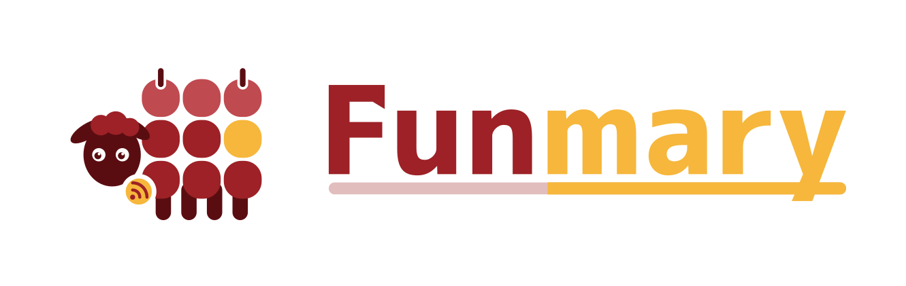

<div align="center">
  <picture>
    <source media="(prefers-color-scheme: dark)" srcset="current/logo/svg/logo-dark-transparent.svg" />
    
  </picture>
</div>

# Funmary assets

[Funmary](https://github.com/funmary-app/funmary) のロゴとアイコンの画像を置くリポジトリです。元のデザインは Figma のファイル「Funmary Design」にあり、ここにはそこから書き出した画像を置きます。

> [!IMPORTANT]
> 画像は、Funmary のコードのライセンス (BSD-3-Clause OR Apache-2.0) の対象外です。宣伝や紹介に改変せずに使うのは自由ですが、サービスの運営や改変には許可が要ります。詳しくは [LICENSE-ASSETS](LICENSE-ASSETS) を見てください。

## 現在の版

v3.1

## フォルダの構成

```
current/        現在の版
  icon/
    svg/        アイコンの SVG (正本)
    png/        SVG から作った PNG。等倍 (512px) と @2x (1024px)
  logo/
    svg/        ロゴの SVG (正本)
    png/        SVG から作った PNG。等倍と @2x
  social/
    svg/        SNS、Discord、GitHub に登録する画像の SVG (正本)
    png/        SVG から作った PNG。各サービスの決まった大きさの等倍だけ
archives/
  v<版>/        過去の版。その版のときの current/ を、同じ構成のまま残したもの
extras/
  parody/       パロディ。デザインの版とは関係なく置く (svg/ と png/ の構成は同じ。PNG は等倍だけ)
scripts/
  build.js      SVG の最適化と PNG の生成
```

デザインの版に属する画像は、すべて `current/` に置きます。リンクするときに版を意識しなくて済むように、`current/` の中の置き場所は版が変わっても変えません。

## ファイル名

### current/icon/ と current/logo/

```
icon[-no-bubble]-<色>-<形>[-border].svg
logo-<色>-<形>[-border].svg
```

| 部分 | 値 |
| --- | --- |
| `-no-bubble` | 吹き出しなし |
| `<色>` | `light` (明るい背景向け) か `dark` (暗い背景向け) |
| `<形>` | `rounded` (角丸の背景)、`square` (四角の背景)、`transparent` (背景なし) |
| `-border` | 縁取り付き |

PNG は同じ名前で、等倍が `<名前>.png`、2 倍が `<名前>@2x.png` です。

### current/social/

| ファイル | 使う場所 | 大きさ |
| --- | --- | --- |
| `ogp-light` | URL を共有したときの画像 (OGP) | 1200×630 |
| `github-social-preview-light` | GitHub のリポジトリの Social preview | 1280×640 |
| `github-org-avatar-light` | GitHub の Organization のアイコン | 1024×1024 |
| `discord-server-icon-light` | Discord のサーバーのアイコン | 512×512 |
| `discord-server-banner-light` | Discord のサーバーのバナー | 1920×1080 |
| `discord-server-banner-dark` | Discord のサーバーのバナー (暗い背景) | 1920×1080 |
| `discord-invite-background-light` | Discord の招待リンクの背景 | 1920×1080 |
| `discord-bot-avatar-light` | Discord の Bot のアイコン | 1024×1024 |
| `discord-bot-banner-light` | Discord の Bot のプロフィールのバナー | 1360×480 |

### extras/parody/

| ファイル | 内容 |
| --- | --- |
| `pc-buying-guide` | 「はこだて未来大学の学生向けPCの選び方」 |

## 使い方

GitHub の raw の URL で直接読み込めます。

```
https://raw.githubusercontent.com/funmary-app/assets/main/current/icon/svg/icon-light-rounded.svg
```

版を固定したいときは、`main` の代わりにタグ (例: `v3.1`) を指定してください。

## 画像を更新する

1. Figma で、更新したノード (アイコンのコンポーネントや、ロゴのフレームなど) を SVG で書き出す。文字はアウトライン化された状態で書き出す
2. 書き出した SVG を、上の規則の名前で各フォルダの `svg/` に置く
3. `npm install` と `npm run build` を実行する。SVG が最適化され、`png/` が作り直される
4. SVG と PNG をまとめてコミットする

`npm run build` は何度実行しても同じ結果になるので、PNG の差分が出たら SVG が変わったということです。

## 版を改める

デザインの版 (v3.1 など) が変わるときは、上書きする前に今の版を残します。

1. `git mv current archives/v<今の版>` で、今の版をまるごと移す (例: `archives/v3.1/icon/svg/...`)
2. 新しい版を `current/` に置き、`npm run build` を実行する
3. この README の「現在の版」を書き換える
4. マージしたら、そのコミットに `v<新しい版>` のタグを付け、同じ名前で GitHub の Release を作る

`archives/` の SVG は、写したあとは変更しません。詳しくは [archives/README.md](archives/README.md) を見てください。

## ライセンス

- 画像 (`current/`、`archives/`、`extras/`): [LICENSE-ASSETS](LICENSE-ASSETS)
- それ以外 (`scripts/` などのコードと設定): BSD 3-Clause License ([LICENSE-BSD-3-CLAUSE](LICENSE-BSD-3-CLAUSE)) と Apache License, Version 2.0 ([LICENSE-APACHE-2.0](LICENSE-APACHE-2.0)) のデュアルライセンス (SPDX の式では `BSD-3-Clause OR Apache-2.0`)

## クレジット

ロゴの文字には、フォント「07あかずきんポップ」を使っています。フリーダウンロード: <https://flopdesign.booth.pm/items/1748058>

ほかの画像に使っているフォントは [CREDITS.md](CREDITS.md) を見てください。
